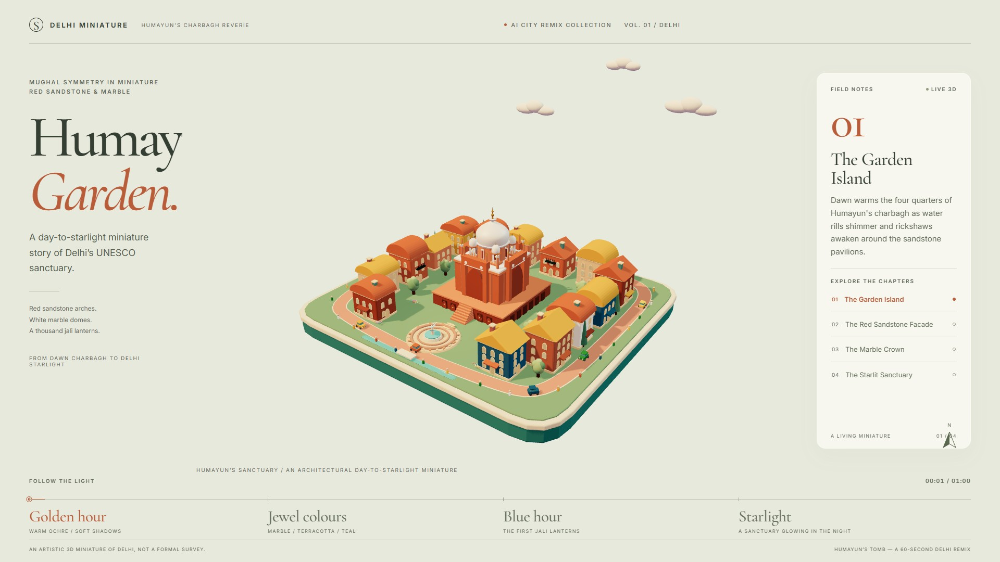
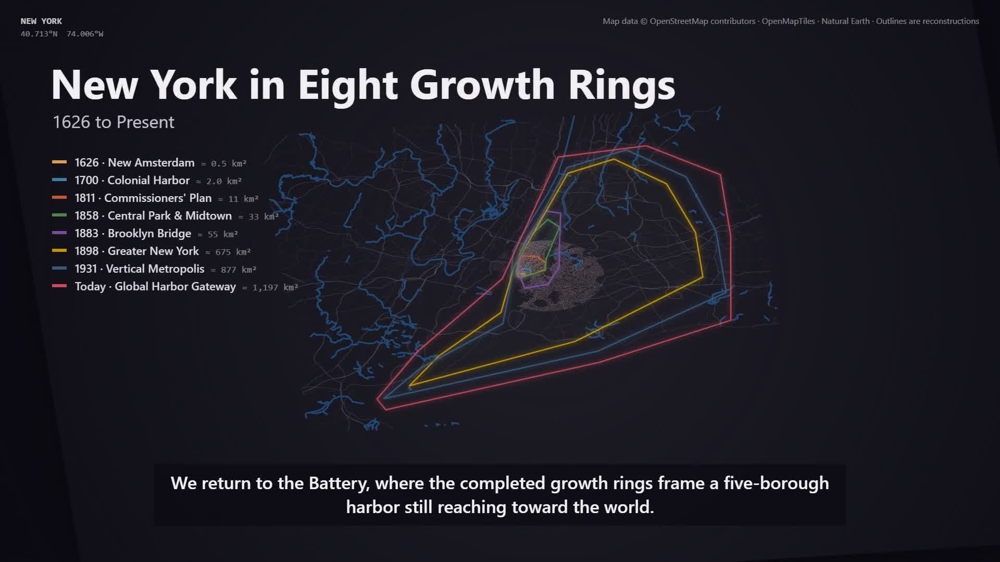
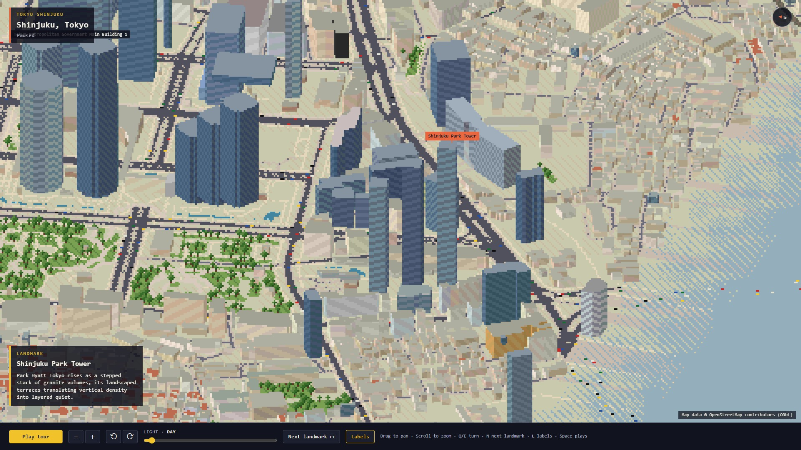
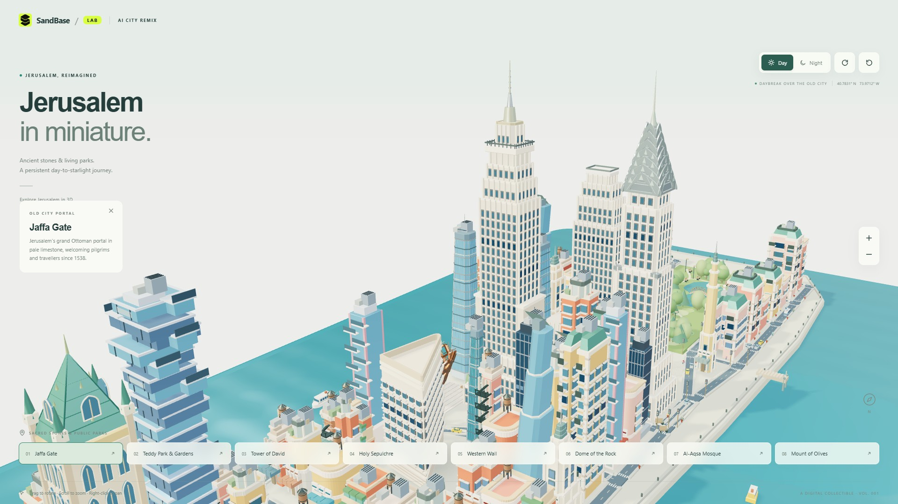
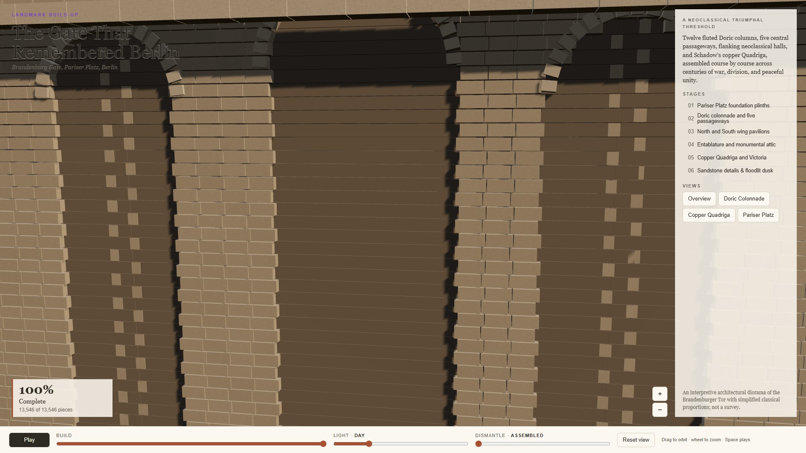
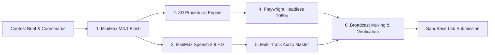

<div align="center">

# 🏙️ AI City Remix Workflows (2026)
### Autonomous Generative Pipelines for the SandBase Global City Remix Contest

[](https://www.sandbase.ai/lab/event/aicityremix)
[](https://www.sandbase.ai)
[](https://www.sandbase.ai)
[](LICENSE)
[]()

<p align="center">
  <em>An open-source generative film laboratory crafting 3D architectural diorama films across global cities. Every city entry pairs a <b>completely unique official procedural skill</b> with <b>MiniMax M3.1 Flash</b> reasoning direction and <b>MiniMax Speech 2.8 HD</b> cinematic vocal narration.</em>
</p>

</div>

---

## 🏆 Submitted City Entries & Workflows

| City | Assigned Official Skill | Film Title | Cover & Preview | Duration | Status | Live Contest Entry | Workflow Doc |
|:---:|:---:|:---:|:---:|:---:|:---:|:---:|:---:|
| **Delhi** | `stone-stars-city` | *Delhi: Seven Cities Under the Open Sky* |  | `60.00s` | **Submitted** (`pending`) | [🔗 View Entry `4fd000af`](https://www.sandbase.ai/lab/event/aicityremix/e/4fd000af-47fe-4d56-a76c-afb3b3c91690) | [Delhi Workflow](workflows/delhi.md) |
| **New York** | `city-through-time` | *New York: Eight Eras in Stone and Steel* |  | `103.40s` | **Submitted** (`pending`) | [🔗 View Entry `3de5c12a`](https://www.sandbase.ai/lab/event/aicityremix/e/3de5c12a-6883-44dc-b65a-3b759eb2f2f1) | [New York Workflow](workflows/new-york.md) |
| **Tokyo** | `pixel-iso-city` | *Tokyo: The Map That Learned to Breathe* |  | `60.00s` | **Submitted** (`pending`) | [🔗 View Entry `9b9a053a`](https://www.sandbase.ai/lab/event/aicityremix/e/9b9a053a-2388-45d7-933b-3f3717a601e0) | [Tokyo Workflow](workflows/tokyo.md) |
| **Jerusalem** | `manhattan-miniature` *(adapted)* | *Jerusalem in Stone: A Life from Daybreak to Starlight* |  | `60.00s` | **Submitted** (`pending`) | [🔗 View Entry `83a67a57`](https://www.sandbase.ai/lab/event/aicityremix/e/83a67a57-1482-4ec4-b151-35af89fefb0e) | [Jerusalem Workflow](workflows/jerusalem.md) |
| **Berlin** | `landmark-buildup` | *The Gate That Remembered Berlin* |  | `60.00s` | **Submitted** (`pending`) | [🔗 View Entry `4b3714c7`](https://www.sandbase.ai/lab/event/aicityremix/e/4b3714c7-e59c-4821-8673-a2569af5b6c7) | [Berlin Workflow](workflows/berlin.md) |

> 📌 *Note: In accordance with contest rules and strict uniqueness criteria, no Skill/template is ever reused across entries. For details on upcoming cities (Athens, Shanghai, Venice, Prague, Moscow, Bangkok), see the [Upcoming Cities Roadmap](workflows/upcoming-cities.md).*

---

## 🧭 Repository Navigation

```
ai-city-remix-workflows/
├── README.md                          # Master directory and contest submission portal
├── workflows/                         # Dedicated workflow breakdowns for each entry
│   ├── pipeline-architecture.md       # Full end-to-end multi-agent architectural specification
│   ├── delhi.md                       # Stone-Stars-City workflow (Delhi observatories & 7 cities)
│   ├── new-york.md                    # City-Through-Time workflow (New York 400-year evolution)
│   ├── tokyo.md                       # Pixel-Iso-City workflow (Tokyo 3,544 OSM building bake)
│   ├── jerusalem.md                   # Miniature Diorama workflow (Jerusalem day-to-starlight)
│   ├── berlin.md                      # Landmark-Buildup workflow (Berlin Brandenburg Gate)
│   └── upcoming-cities.md             # Skill allocation matrix for queued global cities
├── assets/                            # Visual media assets for documentation
│   ├── covers/                        # High-resolution film cover posters
│   └── screenshots/                   # Verification proofs and diorama inspection captures
├── delhi-film/                        # Full production codebase for Delhi entry
├── new-york-film/                     # Full production codebase for New York entry
├── tokyo-film/                        # Full production codebase for Tokyo entry
├── jerusalem-film/                    # Full production codebase for Jerusalem entry
├── templates/                         # Extracted official contest skill templates
└── contest-submit.py                  # Official SandBase contest upload & submission client
```

---

## ⚙️ The Generative Pipeline

Every entry in this repository follows a rigorous 6-stage autonomous workflow:



### 1. Creative Direction with MiniMax M3.1 Flash
The reasoning model `minimax/minimax-m3.1-flash` acts as director, establishing:
- A cohesive story arc connecting landmarks through public spaces.
- Bilingual copy and architectural fact cards in English and Simplified Chinese (`zh-CN`).
- Precise shot timings matching vocal cadences to 3D camera arrival windows.

### 2. 3D Procedural & Cartographic Modeling
- Three.js WebGL2 procedural architecture with dynamic lighting, shadow maps, and custom shaders.
- Direct OpenStreetMap footprint ingestion (`bake-area.mjs`) yielding thousands of real-world structures.
- True Day-to-Night and Golden Hour lighting transitions driven by virtual clocks.

### 3. Audio Narration (MiniMax Speech 2.8 HD)
- Voiced using `English_CaptivatingStoryteller` at 1.05x speed with English language enhancement.
- Individual landmark speech clips positioned across the timeline with millisecond accuracy using FFmpeg `adelay` and mixed with `amix`.

### 4. Deterministic Frame Capture
- Frame-by-frame virtual time stepping (`window.__scene.step(1, 1/30)`) in headless Chromium via Playwright.
- Guarantees zero dropped frames, zero stutter, and identical 1080p 30fps output on any hardware.

### 5. Automated Verification Suites
- Built-in `shoot.mjs` verification suites executing 40 to 55 comprehensive checks:
  - CSP violation monitoring.
  - Interactive camera orbit, zoom, pan, and reset verification.
  - Touch emulation and mobile layout validation.
  - Pixel diff proofs confirming visual changes across all states.

### 6. Muxing & Submission
- Audio padded with `apad` to ensure exact duration compliance (60.0s to 180.0s).
- Crisp high-contrast burned-in subtitles via `subtitles.srt`.
- Direct API upload and submission verification using `contest-submit.py`.

---

## 💻 Quickstart: Reproducing Any Entry

### Prerequisites
- Node.js >= 22.4
- Python 3.10+
- FFmpeg installed and available in system `PATH`
- Google Chrome or Chromium

### Execution
Clone the repository and inspect any city:

```bash
# Clone repository
git clone https://github.com/toufiqfarhan0/ai-city-remix-workflows.git
cd ai-city-remix-workflows

# Example: Run Jerusalem diorama
cd jerusalem-film
npm ci
npm run dev

# Run automated 50-check test suite
npm run build:single
npm run shoot -- --file dist-single/index.html

# Record film
npm run record -- --file dist-single/index.html --out film
```

---

## ⚖️ Contest Declarations & Attribution

- **AI Tools Used:** MiniMax M3.1 Flash reasoning model (`minimax/minimax-m3.1-flash`), MiniMax Speech 2.8 HD (`sandbase_minimax_speech_2_8_hd`).
- **Cartography & Maps:** © OpenStreetMap contributors (where OSM data is utilized).
- **Rights & Originality:** All procedural 3D models, shaders, scripts, and synthesized audio were generated specifically for this contest without copyrighted material or depictions of living individuals.
- **Duration & Formats:** All submissions strictly adhere to the 60–180s duration contract, 1080p resolution, MP4 containers under 100 MiB, and covers under 5 MiB.
