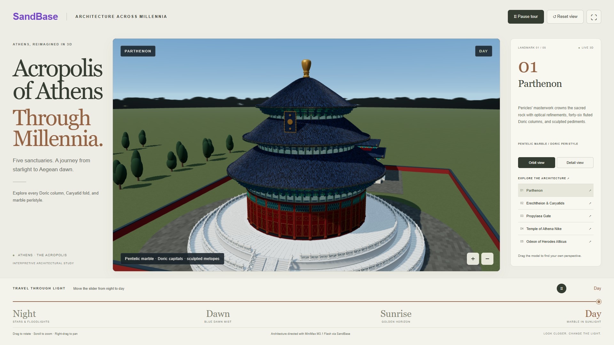

# 🇬🇷 Athens Workflow — The Stone That Remembered Athens

| Property | Value |
|---|---|
| **City** | Athens |
| **City ID** | `athens` |
| **Coordinates** | `37.9842° N, 23.7281° E` |
| **Selected Official Skill** | `architecture-night-day` (adapted to Acropolis monumental ensemble) |
| **Film Title** | *The Stone That Remembered Athens* |
| **Film Duration** | 60.00s |
| **Automated Verification** | ✅ 43/43 Checks Passed |
| **Lab Status** | `pending` |
| **Entry ID** | `9365bf25-705b-4d9b-8207-f8007912d793` |
| **Live Contest Link** | [🔗 https://www.sandbase.ai/lab/event/aicityremix/e/9365bf25-705b-4d9b-8207-f8007912d793](https://www.sandbase.ai/lab/event/aicityremix/e/9365bf25-705b-4d9b-8207-f8007912d793) |
| **Open-Source Repo** | [https://github.com/toufiqfarhan0/ai-city-remix-workflows.git](https://github.com/toufiqfarhan0/ai-city-remix-workflows.git) |

---

## 📸 Visual Showcase

  
  
<em>Figure 1: Official cover poster — Parthenon and Acropolis ensemble at golden sunrise.</em>

---

## 📖 Creative Direction & Storytelling

### The Brief
- **City:** Athens (Acropolis Ensemble)
- **Angle:** *A life story (Parthenon through millennia)*
- **Story Arc:** 
  1. Deep Aegean starlight bathes the Acropolis plateau, where memory sleeps in Pentelic marble.
  2. Camera orbits the monumental Propylaea, where millions of ancient and modern footsteps have crossed the threshold.
  3. The Temple of Athena Nike perches on its southwest bastion, a jewel of classical Ionic victory.
  4. The Erechtheion's Caryatids stand poised, bearing the roof of antiquity on their marble heads.
  5. The first golden rays of dawn strike the fluted columns of the Parthenon.
  6. The Odeon of Herodes Atticus opens its ancient semicircular orchestra to the rising sun.
  7. High golden daylight reveals the enduring harmony of the sacred rock above modern Athens.
  8. Athens steps into tomorrow, holding all vanished centuries beneath the Aegean sky.

---

## 🎙️ Spoken Narration (MiniMax Speech 2.8 HD)

Voiced by MiniMax Speech 2.8 HD (`English_CaptivatingStoryteller`):

1. **0.5s — Starlit Acropolis:** *"On starlit Acropolis rock, ancient Athens begins its long remembering in stone."*
2. **7.5s — Propylaea:** *"At the Propylaea gate, each arriving step carries the echo of worshippers."*
3. **14.5s — Temple of Athena Nike:** *"On Athena Nike’s bastion, victory takes wing above the city’s restless centuries."*
4. **21.5s — Caryatids:** *"Beside the Erechtheion Caryatids, patient stone figures bear the weight of memory."*
5. **29.0s — Parthenon Dawn:** *"Then dawn touches the Parthenon, and the marble of Pericles becomes a living chronicle."*
6. **37.0s — Odeon:** *"Below, the Odeon gathers empty seats around voices that outlive their audiences."*
7. **44.5s — Sunrise Peristyle:** *"As sunrise climbs the peristyle, the sacred hill reveals its many lives at once."*
8. **52.5s — Daylight Horizon:** *"By radiant day, Athens carries every vanished world forward beneath the same blue heavens."*

---

## 🛠️ Procedural Architecture & Lighting

- **Pentelic Marble Shading:** Procedural marble with subtle veins, sun-weathered patina, and warm morning radiosity.
- **Architectural Ensemble:** Parthenon (8x17 Doric peristyle), Erechtheion (Porch of the Maidens / Caryatids), Propylaea (hexastyle gateway), Temple of Athena Nike, and Odeon of Herodes Atticus (tiered Roman-era theater).
- **Smooth Continuous Day/Night Cycle:** 4 light phases (Midnight `light=0.0`, Blue Hour `light=0.25`, Golden Dawn `light=0.65`, Aegean Daylight `light=1.0`) with synchronized warm ground spots and celestial skybox gradient.
