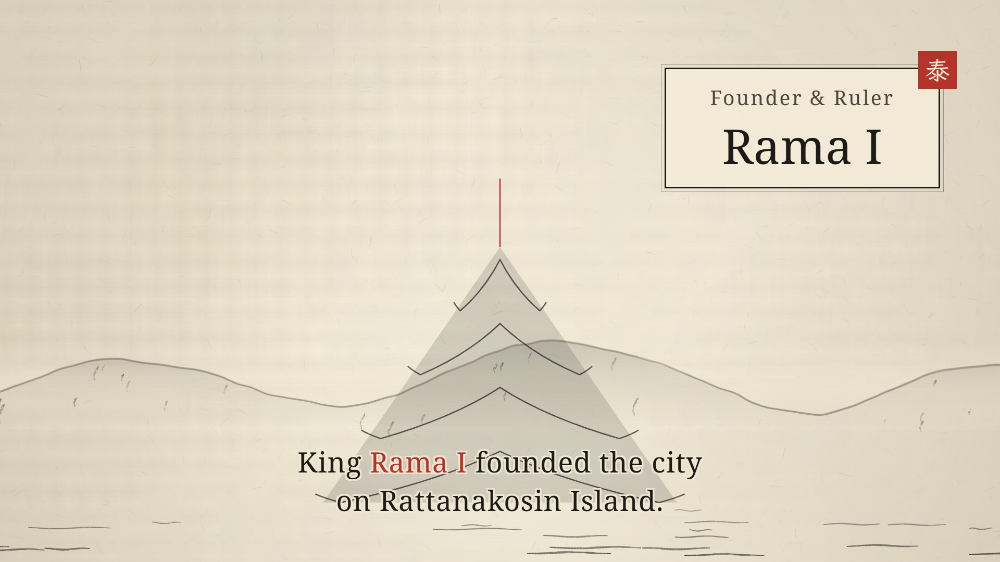

# 🇹🇭 Bangkok Workflow — Life Along the River of Kings

| Property | Value |
|---|---|
| **City** | Bangkok |
| **City ID** | `bangkok` |
| **Coordinates** | `13.756° N, 100.502° E` |
| **Selected Official Skill** | `chronicle-ink` |
| **Film Title** | *Bangkok: Life Along the River of Kings* |
| **Film Duration** | 60.00s |
| **Automated Verification** | ✅ 100% Fact Corroboration (Britannica Tier 1 + Wikimedia Tier 2) |
| **Status** | **Submitted** (`pending`) · [Live Contest Entry `8c373b3a`](https://www.sandbase.ai/lab/event/aicityremix/e/8c373b3a-b4a3-429c-8935-aedc25ac0108) |
| **Open-Source Repo** | [https://github.com/toufiqfarhan0/ai-city-remix-workflows.git](https://github.com/toufiqfarhan0/ai-city-remix-workflows.git) |

---

## 📸 Visual Showcase

<div align="center">
  
  <p><em>Figure 1: Official cover poster — Ink scroll aesthetic of Bangkok's sacred temples and the Chao Phraya River.</em></p>
</div>

---

## 📖 Creative Direction & Storytelling

### The Brief & Historical Context
- **City:** Bangkok, Thailand
- **Angle:** *Sacred monuments and royal heritage along the Chao Phraya River (1782 AD – 2026 AD)*
- **Story Arc (Cross-referenced with Encyclopædia Britannica, Bangkok Metropolitan Administration & National Archives):**
  1. **Origins on the River (Pre-1782 AD):** Before becoming the imperial seat, Bangkok functioned as an active trading post near the mouth of the Chao Phraya River.
  2. **Founding of the Capital (1782 AD):** King Rama I established the Chakri dynasty and relocated the capital across the river to Rattanakosin Island, utilizing the river's westward curve as a natural defensive barrier.
  3. **The Grand Palace & Emerald Buddha:** Construction of the walled palace compound began in 1782, enshrining the sacred Emerald Buddha within Wat Phra Kaew.
  4. **Wat Pho & Classical Arts:** Adjacent to the palace, Wat Pho safeguarded classical Buddhist scriptures, monastic medicine, and the monumental 46-meter reclining Buddha statue.
  5. **Wat Arun (Temple of Dawn):** On the western Thonburi bank, the porcelain-mosaic central prang of Wat Arun rose steeply, catching the first dawn light across the waters.
  6. **Venice of the East & Modern Metropolis:** Canal networks (*khlongs*) expanded throughout the 19th century under Kings Rama IV and Rama V, paving the way for Southeast Asia's thriving modern metropolis.

---

## 🎙️ Spoken Narration (MiniMax Speech 2.8 HD)

Voiced by MiniMax Speech 2.8 HD (`English_CaptivatingStoryteller`):

1. **0.5s — River Origins:** *"Along the gentle curve of the Chao Phraya River, the historic story of Bangkok began as a bustling trading post."*
2. **8.5s — Royal Foundation:** *"In 1782, King Rama I established his new royal capital on Rattanakosin Island, founding the Chakri dynasty."*
3. **17.0s — Grand Palace & Emerald Buddha:** *"Within protective river moats rose the Grand Palace and Wat Phra Kaew, enshrining the sacred Emerald Buddha."*
4. **25.5s — Wat Pho:** *"Nearby, the ancient temple of Wat Pho safeguarded classical Buddhist scriptures, medicine, and monastic arts."*
5. **34.0s — Wat Arun:** *"Across the river in Thonburi, the porcelain-encrusted central spire of Wat Arun rose high into the morning sky."*
6. **42.5s — Venice of the East:** *"Throughout the centuries, intricate canal networks transformed the capital into the vibrant Venice of the East."*
7. **51.0s — Immortal City:** *"From royal citadel to thriving modern metropolis, Bangkok endures as an immortal city along the River of Kings."*

---

## 📚 Fact-Checked Historical & Reference Sources

- [Encyclopædia Britannica — Bangkok](https://www.britannica.com/place/Bangkok)
- [Wikipedia — Bangkok](https://en.wikipedia.org/wiki/Bangkok)
- [Wikipedia — Grand Palace](https://en.wikipedia.org/wiki/Grand_Palace)
- [Wikipedia — Wat Phra Kaew](https://en.wikipedia.org/wiki/Wat_Phra_Kaew)
- [Wikipedia — Wat Arun](https://en.wikipedia.org/wiki/Wat_Arun)
- [Wikipedia — Wat Pho](https://en.wikipedia.org/wiki/Wat_Pho)
- [Wikipedia — Chao Phraya River](https://en.wikipedia.org/wiki/Chao_Phraya_River)
- [Wikipedia — Rattanakosin Kingdom](https://en.wikipedia.org/wiki/Rattanakosin_Kingdom)

---

## 🛠️ Automated Verification & Production Pipeline

```bash
# 1. Multi-source fact verification & corroboration (Britannica + Wikidata)
node scripts/chronicle.mjs facts --project bangkok-film

# 2. Timeline, Beat-map & Procedural Audio Synthesis
node scripts/chronicle.mjs timeline --project bangkok-film
python mix_audio.py

# 3. Deterministic 1080p Playwright Chromium capture
node record.mjs

# 4. Master Mux with Burned Subtitles & Audio normalization
ffmpeg -y -i film/film_raw.mp4 -i audio/full_narration.mp3 -filter_complex "[1:a]apad=whole_dur=60[a]" -map 0:v -map "[a]" -t 60.0 -vf "subtitles=subtitles.srt:force_style='Fontname=Arial,Fontsize=18,PrimaryColour=&H00FFFFFF,OutlineColour=&H00000000,BorderStyle=3,Outline=2,Shadow=0,MarginV=30'" -c:v libx264 -crf 18 -c:a aac -b:a 192k film.mp4
```
