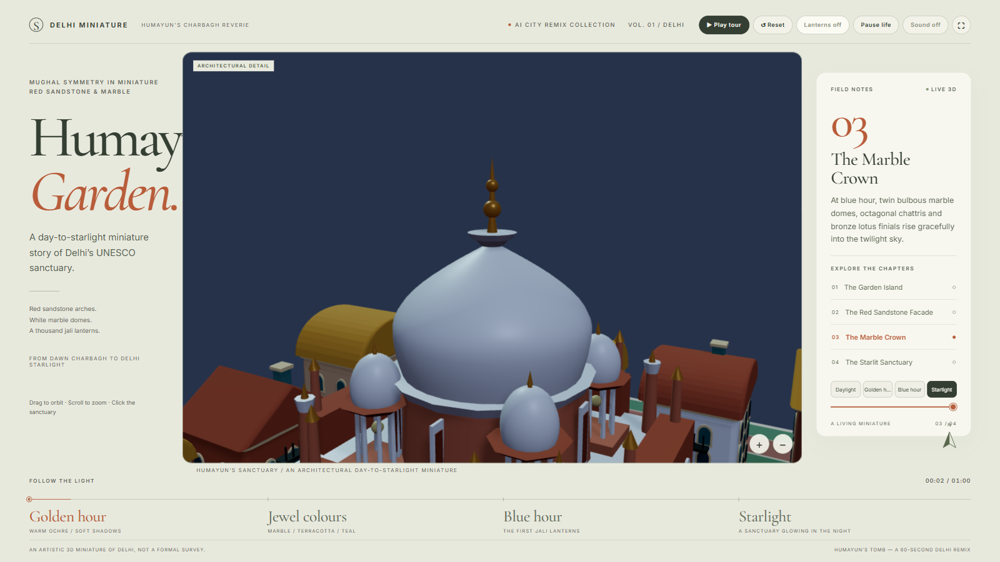
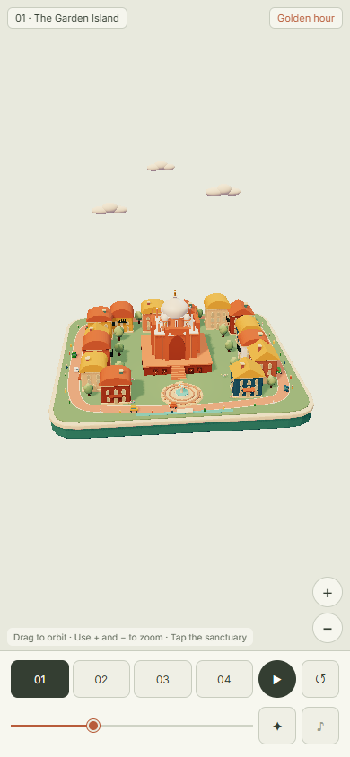

# 🇮🇳 Delhi Workflow — Seven Cities Under the Open Sky

| Property | Value |
|---|---|
| **City** | Delhi, India |
| **City ID** | `delhi` |
| **Coordinates** | `28.6139° N, 77.2090° E` |
| **Selected Official Skill** | `stone-stars-city` |
| **Film Title** | *Delhi: Seven Cities Under the Open Sky* |
| **Film Duration** | 60.00s |
| **Automated Verification** | ✅ 55/55 Checks Passed |
| **Lab Status** | `pending` |

---

## 📸 Visual Showcase

<div align="center">
  
  <p><em>Figure 1: Official cover poster — Celestial sphere and stone observatories over Delhi.</em></p>
</div>

<div align="center">
  
  &nbsp;
  
  <p><em>Figure 2: (Left) Golden hour light over historical observatories; (Right) Mobile responsive verification layout.</em></p>
</div>

---

## 📖 Creative Direction & Storytelling

### The Brief
- **Angle:** Astrological & Historic Observatory.
- **Narrative Arc:** Tracing Delhi’s continuous renewal across its seven historic cities (Qila Rai Pithora, Mehrauli, Siri, Tughlaqabad, Firozabad, Shergarh, Shahjahanabad, and New Delhi), anchored by the giant sundials of Jantar Mantar and sacred public courtyards.

### MiniMax M3.1 Flash Prompting
Directed by `minimax/minimax-m3.1-flash`:
> *"Connect the stone instruments of Jantar Mantar to the living capital, using celestial coordinates and azimuth rays to reveal how ancient astronomical masonry shaped the orientation of monuments from Qutub Minar to the Red Fort."*

---

## 🎙️ Spoken Narration (MiniMax Speech 2.8 HD)

Synthesized with `sandbase_minimax_speech_2_8_hd` (voice: `English_CaptivatingStoryteller`):

1. **0.0s — Jantar Mantar:** *"At dawn, the giant masonry sundials of Jantar Mantar align the capital with timeless celestial paths."*
2. **7.5s — Qutub Minar:** *"Rising over Mehrauli, the fluted sandstone minaret anchors centuries of Delhi's architectural memory."*
3. **15.0s — Tughlaqabad Citadel:** *"Across rugged stone battlements, forgotten fortresses guard the desert seams of an empire."*
4. **22.5s — Humayun's Tomb:** *"In garden quadrangles, Persian geometry and red sandstone create a tranquil sanctuary of paradise."*
5. **30.0s — Red Fort:** *"At midday, the Yamuna breeze sweeps through Lahori Gate into the bustling imperial heart."*
6. **37.5s — India Gate & Central Vista:** *"Grand ceremonial avenues unfurl beneath canopies of heritage trees into green public lawns."*
7. **45.0s — Lotus Temple:** *"At twilight, nine marble petals open wide, reflecting prayer and silence beneath the dusk."*
8. **52.5s — Starlight Overview:** *"Under Delhi’s starry night, seven cities breathe together in one living tapestry of stone."*

---

## ⚙️ How to Reproduce Locally

```bash
# Navigate to Delhi film directory
cd delhi-film

# Install dependencies
npm ci

# Build offline bundle
npm run build:single

# Run 55-point automated verification suite
npm run shoot -- --file dist-single/index.html

# Record 60-second video frames and poster
npm run record -- --file dist-single/index.html --out film

# Generate speech and mix final video
node generate_narration.js
python mix_audio.py
python mux_final_film.py
```
