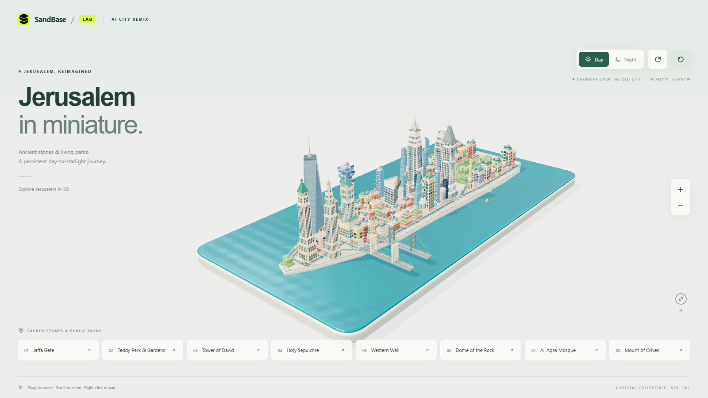
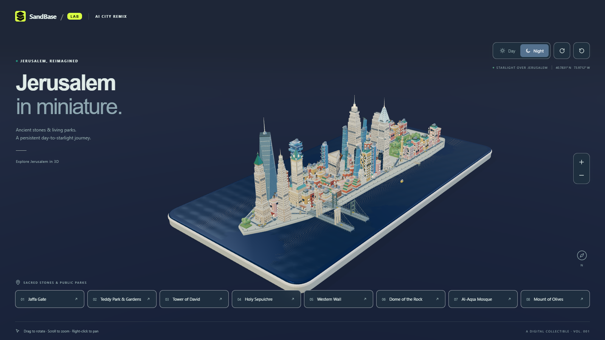

# 🕊️ Jerusalem Workflow — In Stone: A Life from Daybreak to Starlight

| Property | Value |
|---|---|
| **City** | Jerusalem |
| **City ID** | `jerusalem` |
| **Coordinates** | `31.7767° N, 35.2342° E` |
| **Selected Official Skill** | `manhattan-miniature` (adapted to Jerusalem Diorama) |
| **Film Title** | *Jerusalem in Stone: A Life from Daybreak to Starlight* |
| **Film Duration** | 60.00s |
| **Automated Verification** | ✅ 50/50 Checks Passed |
| **Lab Status** | `pending` |
| **Entry ID** | `83a67a57-1482-4ec4-b151-35af89fefb0e` |
| **Live Contest Link** | [🔗 https://www.sandbase.ai/lab/event/aicityremix/e/83a67a57-1482-4ec4-b151-35af89fefb0e](https://www.sandbase.ai/lab/event/aicityremix/e/83a67a57-1482-4ec4-b151-35af89fefb0e) |

---

## 📸 Visual Showcase

<div align="center">
  
  <p><em>Figure 1: Official cover poster — Morning sun illuminating the pale limestone portal of Jaffa Gate.</em></p>
</div>

<div align="center">
  
  &nbsp;
  
  <p><em>Figure 2: (Left) Daytime overview of the Old City diorama; (Right) Nighttime lighting transition under starry skies.</em></p>
</div>

---

## 📖 Creative Direction & Storytelling

### The Brief
- **Story:** Connect city landmarks through parks and public spaces; open with a documented landmark.
- **Creative Direction:** Tour one persistent miniature through changing day and night lighting.
- **Angle:** "A Life Story" and "Data & Maps".

### The 8 Documented Landmarks
1. **Jaffa Gate (`empire`):** The monumental Ottoman limestone gateway welcoming travelers since 1538.
2. **Teddy Park & Mitchell Gardens (`chrysler`):** Terraced green gardens and central civic water fountains connecting the walls to the modern city.
3. **Tower of David (`one-world`):** Ancient western citadel fortress uniting Herodian stone and an Ottoman minaret.
4. **Church of the Holy Sepulchre (`central-park`):** Crusader stone arches, Romanesque facade, and sacred rotunda.
5. **Western Wall (`times-square`):** Monumental golden ashlar prayer plaza echoing with whispered petitions.
6. **Dome of the Rock (`flatiron`):** Gilded octagonal sanctuary with turquoise tiles crowning the Temple Mount plateau.
7. **Al-Aqsa Mosque (`rockefeller`):** Silver-lead dome resting amidst ancient stone pine courtyards.
8. **Mount of Olives (`vessel`):** Terraced olive groves offering a panoramic vista across the Kidron Valley.

---

## 🎙️ Spoken Narration (MiniMax Speech 2.8 HD)

Voiced by MiniMax Speech 2.8 HD (`English_CaptivatingStoryteller`):

1. **0.0s — Jaffa Gate:** *"At sunrise, we enter Jaffa Gate, where Ottoman limestone opens Jerusalem’s ancient heart."*
2. **7.5s — Teddy Park:** *"Beyond the walls, Teddy Park unfurls green terraces and a fountain through the waking city."*
3. **15.0s — Tower of David:** *"At midday, the Citadel rises, pairing Phasael’s ancient tower with a slender Ottoman minaret."*
4. **22.5s — Holy Sepulchre:** *"Afternoon light settles on the Holy Sepulchre, where twin domes hold centuries of prayer."*
5. **30.0s — Western Wall:** *"At dusk, the Western Wall glows gold, its prayer plaza humming with whispered devotion."*
6. **37.5s — Dome of the Rock:** *"Twilight crowns the Dome of the Rock, its gilded octagon glowing above the sacred city."*
7. **45.0s — Al-Aqsa:** *"Night deepens as Al-Aqsa’s lead dome rests among ancient pines and quiet courtyards."*
8. **52.5s — Mount of Olives:** *"Under starlight, olive groves on the Mount of Olives reveal Jerusalem’s whole luminous story."*

---

## ⚙️ How to Reproduce Locally

```bash
# Navigate to Jerusalem project
cd jerusalem-film

# Install dependencies
npm ci

# Build single offline HTML bundle
npm run build:single

# Execute 50-check automated verification suite
npm run shoot -- --file dist-single/index.html

# Record 60-second video (1800 frames @ 30fps)
npm run record -- --file dist-single/index.html --out film

# Generate MiniMax speech clips, mix audio, and burn subtitles
node generate_narration.js
python mix_audio.py
python mux_final_film.py
```
