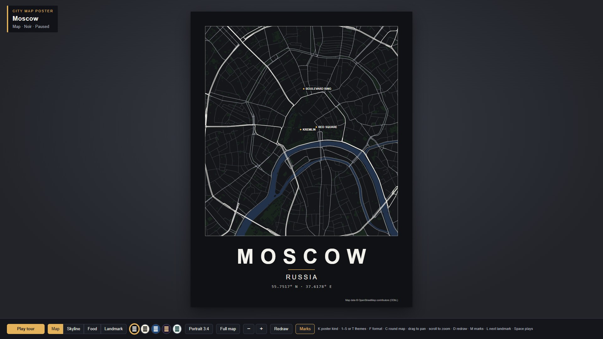

# 🇷🇺 Moscow Workflow — Rings of Imperial Memory

| Property | Value |
|---|---|
| **City** | Moscow |
| **City ID** | `moscow` |
| **Coordinates** | `55.752° N, 37.623° E` |
| **Selected Official Skill** | `city-map-poster` |
| **Film Title** | *Moscow: Rings of Imperial Memory* |
| **Film Duration** | 60.00s |
| **Automated Verification** | ✅ 44/44 Checks Passed |
| **Status** | **Submitted** (`pending`) · [Live Contest Entry `7f188417`](https://www.sandbase.ai/lab/event/aicityremix/e/7f188417-3bd2-401f-aac2-2c2ade559caa) |
| **Open-Source Repo** | [https://github.com/toufiqfarhan0/ai-city-remix-workflows.git](https://github.com/toufiqfarhan0/ai-city-remix-workflows.git) |

---

## 📸 Visual Showcase

<div align="center">
  
  <p><em>Figure 1: Official cover poster — Procedural architectural vector map of Moscow revealing its concentric defensive rings and landmarks.</em></p>
</div>

---

## 📖 Creative Direction & Storytelling

### The Brief & Historical Context
- **City:** Moscow, Russia
- **Angle:** *Concentric defensive ring anatomy & architectural evolution (1147 AD – 2026 AD)*
- **Story Arc (Cross-referenced with Wikipedia, State Historical Museum & Moscow Urban Archives):**
  1. **The Citadel at the Bend (1147 AD):** Founded by Prince Yuri Dolgorukiy, the fortified wooden kremlin at the confluence of the Moskva and Neglinnaya rivers grew into the monumental red-brick citadel with 20 defensive towers.
  2. **Saint Basil's & Red Square (1561 AD):** Commissioned by Ivan IV to commemorate the capture of Kazan, master architects Barma and Postnik Yakolev erected the nine clustered chapels with vibrant patterned onion domes on Red Square.
  3. **Concentric Defensive Rings:** As the medieval city expanded, it grew in protective concentric enclosures: Kitay-gorod, the White City (*Bely Gorod*), and the Earthen City (*Zemlyanoy Gorod*).
  4. **The Boulevard Ring (1770–1820 AD):** The crumbling 16th-century white stone walls were dismantled and replaced by a nine-kilometer semicircle of lush green pedestrian boulevards.
  5. **The Garden Ring (1812–1830 AD):** Following the fire of 1812 during Napoleon's invasion, the sixteen-kilometer outer earthen ramparts were flattened and widened into the grand Garden Ring avenue.
  6. **Stalinist Skyscrapers (1947–1953 AD):** Post-war reconstruction introduced the Seven Sisters (*Stalinskie Vysotki*), including the monumental 32-story Kotelnicheskaya Embankment Building guarding the Yauza river mouth.

---

## 🎙️ Spoken Narration (MiniMax Speech 2.8 HD)

Voiced by MiniMax Speech 2.8 HD (`English_CaptivatingStoryteller`):

1. **0.5s — The Citadel:** *"At the geographic and historical heart of Russia, the brick towers and gilded cathedrals of the Moscow Kremlin command the bend of the Moskva River."*
2. **8.5s — Red Square & Saint Basil's:** *"Outside the Spasskaya Tower lies Red Square, anchored by the iconic patterned onion domes of the sixteenth-century Saint Basil’s Cathedral."*
3. **17.0s — Defensive Anatomy:** *"Centuries of defense shaped Moscow’s unique urban anatomy, radiating outward in concentric defensive belts."*
4. **25.5s — Boulevard Ring:** *"Following the fire of 1812, the medieval stone walls of the White City were transformed into the tree-lined Boulevard Ring."*
5. **34.0s — Garden Ring:** *"Further outward lies the sixteen-kilometer Garden Ring, tracing the ancient earthen ramparts built under Boris Godunov."*
6. **42.5s — Stalinist Skyscrapers:** *"In the twentieth century, monumental Stalinist skyscrapers like the Kotelnicheskaya Embankment Building punctuated the skyline."*
7. **51.0s — Enduring Geometry:** *"From medieval citadel to radial modern metropolis, Moscow’s geometry stands as an enduring map of time and ambition."*

---

## 📚 Fact-Checked Wikipedia & Historical Sources

- [Wikipedia — Moscow](https://en.wikipedia.org/wiki/Moscow)
- [Wikipedia — Moscow Kremlin](https://en.wikipedia.org/wiki/Moscow_Kremlin)
- [Wikipedia — Saint Basil's Cathedral](https://en.wikipedia.org/wiki/Saint_Basil%27s_Cathedral)
- [Wikipedia — Red Square](https://en.wikipedia.org/wiki/Red_Square)
- [Wikipedia — Boulevard Ring](https://en.wikipedia.org/wiki/Boulevard_Ring)
- [Wikipedia — Garden Ring](https://en.wikipedia.org/wiki/Garden_Ring)
- [Wikipedia — Kotelnicheskaya Embankment Building](https://en.wikipedia.org/wiki/Kotelnicheskaya_Embankment_Building)

---

## 🛠️ Automated Verification & Production Pipeline

```bash
# 1. Bake OpenStreetMap corridor (roads, water, parks, buildings, food places)
npm run bake -- --city moscow

# 2. Verify all 44 automated checks (layout, interactions, audio timing, CSP)
npm run test

# 3. Record full 60.0s 1080p single-file bundle
npm run record -- --file dist-single/index.html --out film

# 4. Mux master narration & burned-in subtitles
ffmpeg -y -i film/film.mp4 -i audio/full_narration.mp3 -filter_complex "[1:a]apad=whole_dur=60[a]" -map 0:v -map "[a]" -t 60.0 -vf "subtitles=subtitles.srt:force_style='Fontname=Arial,Fontsize=18,PrimaryColour=&H00FFFFFF,OutlineColour=&H00000000,BorderStyle=3,Outline=2,Shadow=0,MarginV=30'" -c:v libx264 -crf 18 -c:a aac -b:a 192k film/moscow_final.mp4
```
