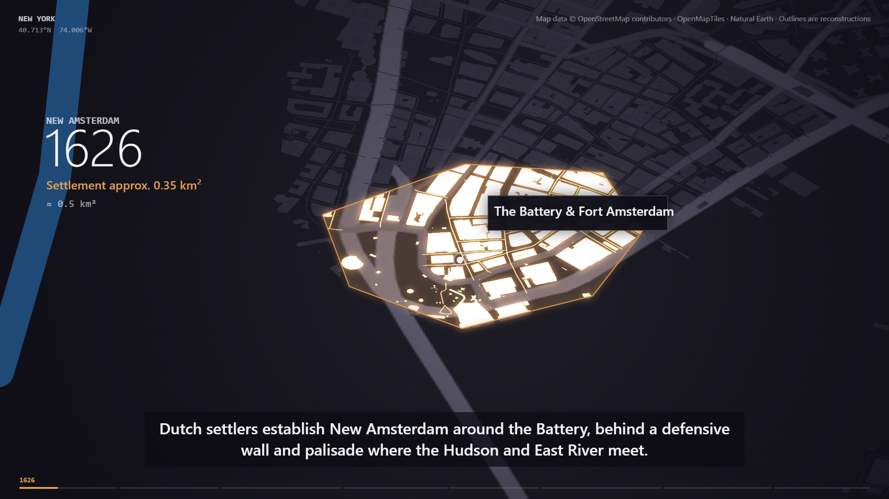

# 🗽 New York Workflow — Eight Eras in Stone and Steel

| Property | Value |
|---|---|
| **City** | New York, United States |
| **City ID** | `new-york` |
| **Coordinates** | `40.7128° N, 74.0060° W` |
| **Selected Official Skill** | `city-through-time` |
| **Film Title** | *New York: Eight Eras in Stone and Steel* |
| **Film Duration** | 103.40s |
| **Automated Verification** | ✅ Verified across 8 temporal epochs |
| **Lab Status** | `pending` |
| **Entry ID** | `3de5c12a-6883-44dc-b65a-3b759eb2f2f1` |
| **Live Contest Link** | [🔗 https://www.sandbase.ai/lab/event/aicityremix/e/3de5c12a-6883-44dc-b65a-3b759eb2f2f1](https://www.sandbase.ai/lab/event/aicityremix/e/3de5c12a-6883-44dc-b65a-3b759eb2f2f1) |

---

## 📸 Visual Showcase

<div align="center">
  
  <p><em>Figure 1: Official cover poster — Concentric temporal rings marking 400 years of New York's evolution.</em></p>
</div>

<div align="center">
  
  <p><em>Figure 2: Procedural historical growth model showing Manhattan shoreline changes and building density expansion.</em></p>
</div>

---

## 📖 Creative Direction & Storytelling

### The Brief
- **Angle:** Multi-Epoch Urban Evolution.
- **Narrative Arc:** Scrubbing through four centuries of continuous vertical and horizontal metamorphosis.

### The 8 Temporal Eras
1. **1609 — Lenapehoking:** Salt marshes, oak hills, and Native footpaths along the island of *Manahatta*.
2. **1664 — New Amsterdam:** Wooden palisades (the future Wall Street), windmill batteries, and Dutch gabled canal houses.
3. **1789 — Federal Capital:** The inauguration at Federal Hall, cobblestone lanes, and maritime wharves along the East River.
4. **1851 — The Grid & Croton:** The Commissioners' Plan of 1811 carves straight avenues; the Croton Aqueduct brings fresh water.
5. **1883 — The Great Bridge:** Roebling's gothic stone towers weave Manhattan to Brooklyn with steel cables.
6. **1931 — Cathedral of Art Deco:** The race to the clouds: Chrysler's sunburst spire and the Empire State Building pierce the sky.
7. **1973 — The Twin Monoliths:** The World Trade Center complex redefining Lower Manhattan’s modern financial silhouette.
8. **2026 — Glass & Starlight:** Ultra-slender pencil towers, elevated High Line greenery, and luminous reflections along the Hudson.

---

## ⚙️ How to Reproduce Locally

```bash
# Navigate to New York film directory
cd new-york-film

# Generate 8-era procedural scene
python generate_ny_eras.py

# Verify timing and audio sync
node scripts/verify_timeline.mjs

# Assemble final film
ffmpeg -y -i film.mp4 -i audio/narration.mp3 -c:v copy -c:a aac -shortest film_final.mp4
```
