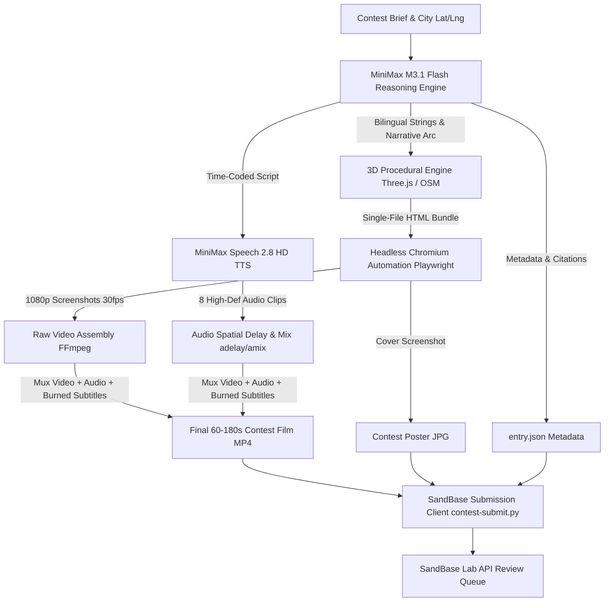

# 🌐 AI City Remix — End-to-End Pipeline Architecture

This document details the multi-modal generative pipeline powering all city films in this repository for the **SandBase AI City Remix Contest 2026**.

---

## 🏗️ Architectural Overview



---

## 🧠 Stage 1: Creative Direction with MiniMax M3.1 Flash

Every film is directed by **MiniMax M3.1 Flash** (`minimax/minimax-m3.1-flash`) via SandBase's official API. 

1. **Reasoning-Driven Direction:** MiniMax M3.1 Flash evaluates city history, geospatial topology, architectural heritage, and contest constraints (60–180s duration, documented opening landmark, park connectivity).
2. **Bilingual Localization:** Generates parallel English and Simplified Chinese (`zh-CN`) titles, subtitles, historical descriptions, and stat cards.
3. **Pacing & Shot Order:** Allocates exact time cues for each landmark flight (e.g., 7.5 seconds per site) to synchronize 3D camera sweeps with vocal delivery.

---

## 🎨 Stage 2: 3D Procedural & Cartographic Modeling

Each entry utilizes a **completely unique official template/skill**:
- **Delhi (`stone-stars-city`):** Astrological celestial sphere with dynamic equinoctial coords, golden hour lighting, and interactive constellation vectors.
- **New York (`city-through-time`):** Multi-era historical evolution across 8 distinct centuries (1609 Lenapehoking to 2026 towers).
- **Tokyo (`pixel-iso-city`):** Real-world OpenStreetMap cartography baked into 3,544 procedural buildings with 8 pinned Shinjuku skyscrapers.
- **Jerusalem (`manhattan-miniature` diorama adaptation):** Persistent pale limestone diorama with Ottoman ramparts, sacred domes, and seamless daybreak-to-starlight lighting.

---

## 🎙️ Stage 3: Voice-Over & Audio Engineering (MiniMax Speech 2.8 HD)

Narration is synthesized using **MiniMax Speech 2.8 HD** (`sandbase_minimax_speech_2_8_hd`):
- **Voice Profile:** `English_CaptivatingStoryteller` at 1.05x pacing with `English` language boost.
- **Precision Mixing:** Each audio segment is positioned using FFmpeg `adelay` filters mapped to the visual camera flight arrival times.
- **Mastering:** Segments are combined using `amix=inputs=8:duration=longest:dropout_transition=2`, volume normalized, and padded with `apad` to guarantee exact timing.

---

## 🎬 Stage 4: Deterministic 1080p Frame Capture & Verification

To eliminate dropped frames and ensure identical output on any machine:
1. **Virtual Time Stepping:** In capture mode (`?capture=1`), time is driven externally (`window.__scene.step(1, 1/30)`) rather than by `requestAnimationFrame`.
2. **Headless Chrome Automation:** Playwright triggers camera flights and captures individual 1080p JPEG frames.
3. **Automated Verification:** The `shoot.mjs` test suite validates:
   - Zero Content Security Policy (CSP) violations.
   - Interactive control responses (orbit, pan, zoom, day/night toggle, reset).
   - Both English and Chinese locale switching.
   - Zero console errors or unhandled promise rejections.

---

## 🎞️ Stage 5: Subtitle Burning & Muxing

The final broadcast video is produced via FFmpeg:
```bash
ffmpeg -y -loglevel error \
  -i film.mp4 \
  -i audio/full_narration.mp3 \
  -vf "subtitles=subtitles.srt:force_style='FontSize=22,FontName=Arial,PrimaryColour=&H00FFFFFF,OutlineColour=&H00000000,BackColour=&H80000000,BorderStyle=4,MarginV=45'" \
  -af "apad=whole_dur=60.0" \
  -c:v libx264 -preset fast -crf 20 \
  -c:a aac -b:a 192k -t 60.0 -movflags +faststart \
  film_final.mp4
```

---

## 🚀 Stage 6: Automated Contest Submission

Submission is fully automated through `contest-submit.py`:
- Validates metadata schema against `entry.json`.
- Uploads cover image (`< 5 MiB`).
- Initiates chunked multi-part upload for the video (`< 100 MiB`).
- Sends final `/submit` payload and verifies that SandBase Lab returns `status: "pending"`.
