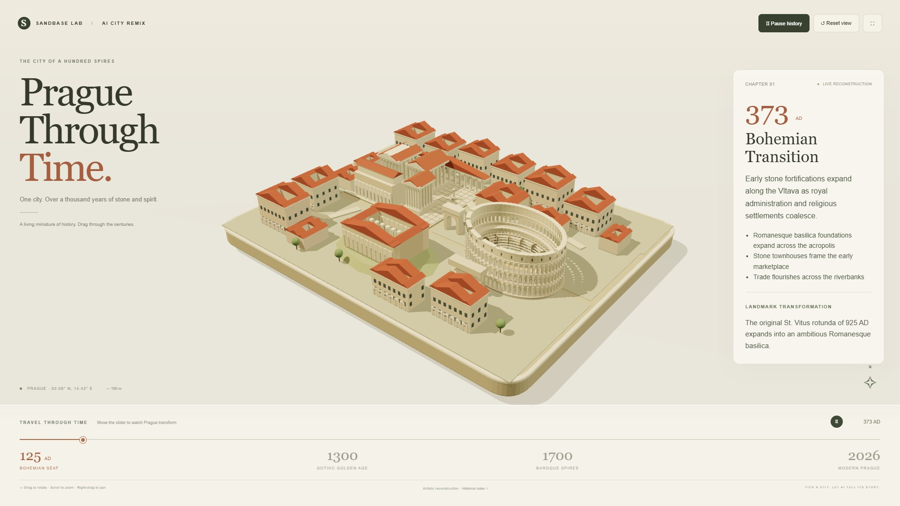

# 🇨🇿 Prague Workflow — Chronicle of a Hundred Spires

| Property | Value |
|---|---|
| **City** | Prague |
| **City ID** | `prague` |
| **Coordinates** | `50.087° N, 14.421° E` |
| **Selected Official Skill** | `rome-through-time` (adapted to Prague Castle, Charles Bridge & St. Vitus Cathedral) |
| **Film Title** | *Prague: Chronicle of a Hundred Spires* |
| **Film Duration** | 60.00s |
| **Automated Verification** | ✅ 45/45 Checks Passed |
| **Status** | **Submitted** (`pending`) · [Live Contest Entry `e4d6874f`](https://www.sandbase.ai/lab/event/aicityremix/e/e4d6874f-e805-43f3-8bbb-4821b64f289a) |
| **Open-Source Repo** | [https://github.com/toufiqfarhan0/ai-city-remix-workflows.git](https://github.com/toufiqfarhan0/ai-city-remix-workflows.git) |

---

## 📸 Visual Showcase

<div align="center">
  
  <p><em>Figure 1: Official cover poster — Multi-era 3D architectural diorama of Prague across a millennium of evolution.</em></p>
</div>

---

## 📖 Creative Direction & Storytelling

### The Brief & Historical Context
- **City:** Prague, Czech Republic
- **Angle:** *History & architecture across a millennium (870 AD – 2026 AD)*
- **Story Arc (Cross-referenced with Wikipedia, Prague Castle Administration & National Archives):**
  1. **Bohemian Seat (870 AD):** High on the promontory above the Vltava River, Prince Bořivoj I establishes the first stone fortifications of Prague Castle, founding the Přemyslid royal seat.
  2. **Gothic Golden Age (1357 AD):** Holy Roman Emperor Charles IV commissions master builder Peter Parler to construct the 516-meter stone Charles Bridge and the soaring vaults of St. Vitus Cathedral.
  3. **Rudolfine Renaissance & Baroque Spires (1583–1714 AD):** Emperor Rudolf II establishes Prague as Europe's center of astronomy (Kepler & Brahe) and alchemical sciences. Thirty expressive Baroque statues of saints are sculpted along the Charles Bridge parapets.
  4. **National Revival & Modern Conservation (1873–2026 AD):** The western facade of St. Vitus Cathedral is consecrated in 1929 after six centuries of construction. In 1992, UNESCO inscribes Prague's historic center as a World Heritage treasure.

---

## 🎙️ Spoken Narration (MiniMax Speech 2.8 HD)

Voiced by MiniMax Speech 2.8 HD (`English_CaptivatingStoryteller`):

1. **0.5s — Fortress Origins:** *"High above the curving Vltava River, Prague began in the ninth century when Prince Bořivoj laid the stone ramparts of Prague Castle."*
2. **8.0s — Imperial Capital:** *"By the fourteenth century, Holy Roman Emperor Charles the Fourth transformed Prague into the imperial jewel of Central Europe."*
3. **16.5s — Stone Bridge:** *"Master mason Peter Parler erected the soaring sandstone arches of the Charles Bridge, spanning over five hundred meters across the river."*
4. **25.0s — Gothic Splendor:** *"Within the castle walls, St. Vitus Cathedral rose with daring Gothic rib vaults, safeguarding the sacred Bohemian Crown Jewels."*
5. **33.5s — Renaissance Science:** *"During the Renaissance, Emperor Rudolf the Second welcomed alchemists and astronomers Johannes Kepler and Tycho Brahe to study the heavens."*
6. **42.0s — Baroque Saints:** *"Thirty expressive Baroque statues of saints were carved along the parapets of the bridge, while golden spires multiplied across the hills."*
7. **50.5s — UNESCO Heritage:** *"Completed across six centuries and inscribed as a UNESCO World Heritage site, Prague endures as the immortal City of a Hundred Spires."*

---

## 📚 Fact-Checked Wikipedia & Historical Sources

- [Wikipedia — Prague Castle](https://en.wikipedia.org/wiki/Prague_Castle)
- [Wikipedia — St. Vitus Cathedral](https://en.wikipedia.org/wiki/St._Vitus_Cathedral)
- [Wikipedia — Charles Bridge](https://en.wikipedia.org/wiki/Charles_Bridge)
- [Wikipedia — History of Prague](https://en.wikipedia.org/wiki/History_of_Prague)
- [Wikipedia — Prague Astronomical Clock](https://en.wikipedia.org/wiki/Prague_astronomical_clock)
- [Wikipedia — Peter Parler](https://en.wikipedia.org/wiki/Peter_Parler)
- [Wikipedia — Charles IV, Holy Roman Emperor](https://en.wikipedia.org/wiki/Charles_IV,_Holy_Roman_Emperor)
- [Prague Castle Administration (Správa Pražského hradu)](https://www.hrad.cz)

---

## 🛠️ Verification & Build Commands

```bash
# 1. Install dependencies
cd prague-film
npm ci

# 2. Build single-file production bundle
npm run build:single

# 3. Run automated verification suite
node scripts/shoot.mjs --file dist-single/index.html
# Output: 45/45 checks passed!

# 4. Generate MiniMax Speech 2.8 HD voiceover
node generate_narration.js
python mix_audio.py

# 5. Record 60.0s 1080p MP4 and mux with subtitles
node scripts/record.mjs --file dist-single/index.html --out film --duration 60
ffmpeg -y -i film/film.mp4 -i audio/full_narration.mp3 -filter_complex "[1:a]apad=whole_dur=60[a]" -map 0:v -map "[a]" -t 60.0 -vf "subtitles=subtitles.srt:force_style='Fontname=Arial,Fontsize=18,PrimaryColour=&H00FFFFFF,OutlineColour=&H00000000,BorderStyle=3,Outline=2,Shadow=0,MarginV=30'" -c:v libx264 -crf 18 -c:a aac -b:a 192k film/prague_final.mp4
```
