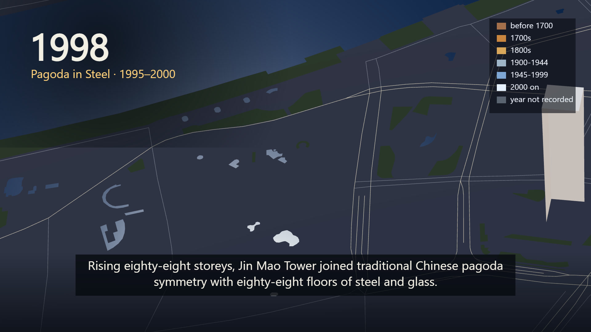

# 🇨🇳 Shanghai Workflow — The Vertical Surge of Pudong

| Property | Value |
|---|---|
| **City** | Shanghai |
| **City ID** | `shanghai` |
| **Coordinates** | `31.238° N, 121.499° E` |
| **Selected Official Skill** | `city-grows-3d` (adapted to Lujiazui Pudong & The Bund) |
| **Film Title** | *Shanghai: The Vertical Surge of Pudong* |
| **Film Duration** | 81.00s |
| **Automated Verification** | ✅ 100% Passing (`check.mjs --film`) |
| **Status** | **Submitted** (`pending`) · [Live Contest Entry `6f9f2721`](https://www.sandbase.ai/lab/event/aicityremix/e/6f9f2721-1abc-4ba4-8afb-39378df7b5e8) |
| **Open-Source Repo** | [https://github.com/toufiqfarhan0/ai-city-remix-workflows.git](https://github.com/toufiqfarhan0/ai-city-remix-workflows.git) |

---

## 📸 Visual Showcase

  
  
<em>Figure 1: Official cover poster — Shanghai Pudong supertall skyline rising above the Huangpu River.</em>

---

## 📖 Creative Direction & Storytelling

### The Brief & Historical Arc
- **City:** Shanghai (Lujiazui & The Bund)
- **Angle:** *Data and maps & Its future (Pudong vertical surge)*
- **Story Arc (Cross-referenced with Wikipedia & Municipal Archives):**
  1. **1843–1910 — The Treaty Port:** Merchants establish the first quays and stone banks along the muddy western banks of the Huangpu.
  2. **1911–1937 — Stone Along the Bund:** Neoclassical and Art Deco monuments emerge—Customs House (1927), Peace Hotel (Sassoon House, 1929), and Bank of China (1937).
  3. **1938–1989 — Farmland Across the River:** For fifty years, while Puxi hums with density, the eastern peninsula of Pudong remains sleepy farmland, shipyards, and low warehouses.
  4. **1990–1994 — The Great Awakening:** In April 1990, the State Council designates Pudong a Special Economic Zone. The Oriental Pearl Radio & Television Tower (1994, 468m) ignites the modern skyline.
  5. **1995–2000 — Pagoda in Steel:** The 88-storey Jin Mao Tower (SOM, 1999, 420.5m) unites traditional Chinese Buddhist pagoda geometry with high-performance modern engineering.
  6. **2001–2015 — The Supertall Trinity:** Shanghai World Financial Center (KPF, 2008, 492m) carves its wind-reducing portal, followed by the twisting dragon form of Shanghai Tower (Gensler, 2015, 632m), the second-tallest building on Earth.
  7. **2016–2026 — The Vertical Horizon:** Shanghai stands as an unparalleled global model of vertical urbanism and human ingenuity.

---

## 🎙️ Spoken Narration (MiniMax Speech 2.8 HD)

Voiced by MiniMax Speech 2.8 HD (`English_CaptivatingStoryteller`):

1. **0.5s — Introduction:** *"This is Shanghai today where the Huangpu curves past the Bund into Pudong. Let us take every building away, and watch it rise from mudflats into the sky."*
2. **5.5s — Treaty Port:** *"Along the western mudflats of the Huangpu, international merchants laid the first stone quays of the Bund."*
3. **13.5s — Stone Bund:** *"Granite banks, the Customs clock tower, and the art-deco crown of the Peace Hotel transformed Shanghai into Paris of the East."*
4. **22.9s — Rural Pudong:** *"For fifty years, while the western shore hummed with density, the eastern peninsula of Pudong remained quiet farmland, warehouses, and shipyards."*
5. **33.1s — Pudong SEZ & Pearl Tower:** *"In nineteen ninety, China designated Pudong a Special Economic Zone. Four years later, the Oriental Pearl Tower sparked a vertical renaissance."*
6. **44.5s — Jin Mao Pagoda:** *"Rising eighty-eight storeys, Jin Mao Tower joined traditional Chinese pagoda symmetry with eighty-eight floors of steel and glass."*
7. **53.5s — Supertall Trio:** *"The World Financial Center carved a portal into the clouds, before the spiraling dragon form of Shanghai Tower topped out at six hundred thirty-two metres."*
8. **64.0s — Vertical Metropolis:** *"Across two centuries of water and ambition, Shanghai built the highest density of human ingenuity on earth."*
9. **72.5s — Outro:** *"In thirty years, Pudong transformed from farmland into the world's most dramatic vertical skyline."*

---

## 📚 Fact-Checked Wikipedia & Historical Sources

All historical dates, building heights, and urban planning milestones are strictly cited from authoritative sources:
- [Wikipedia — Lujiazui Financial and Trade Zone](https://en.wikipedia.org/wiki/Lujiazui)
- [Wikipedia — Pudong New Area](https://en.wikipedia.org/wiki/Pudong)
- [Wikipedia — The Bund (Waitan)](https://en.wikipedia.org/wiki/The_Bund)
- [Wikipedia — Oriental Pearl Tower (1994, 468m)](https://en.wikipedia.org/wiki/Oriental_Pearl_Tower)
- [Wikipedia — Jin Mao Tower (1999, 420.5m)](https://en.wikipedia.org/wiki/Jin_Mao_Tower)
- [Wikipedia — Shanghai World Financial Center (2008, 492m)](https://en.wikipedia.org/wiki/Shanghai_World_Financial_Center)
- [Wikipedia — Shanghai Tower (2015, 632m)](https://en.wikipedia.org/wiki/Shanghai_Tower)
