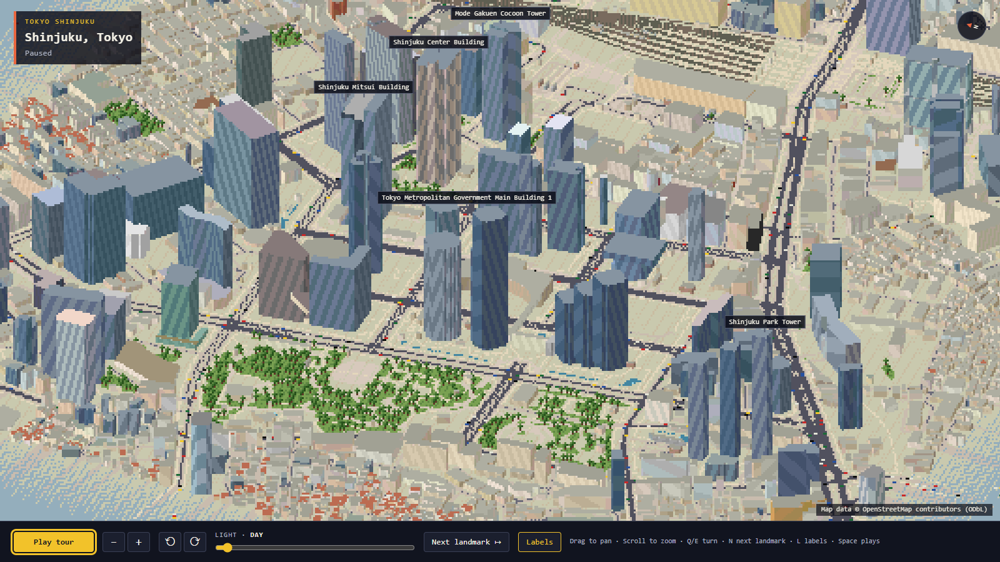
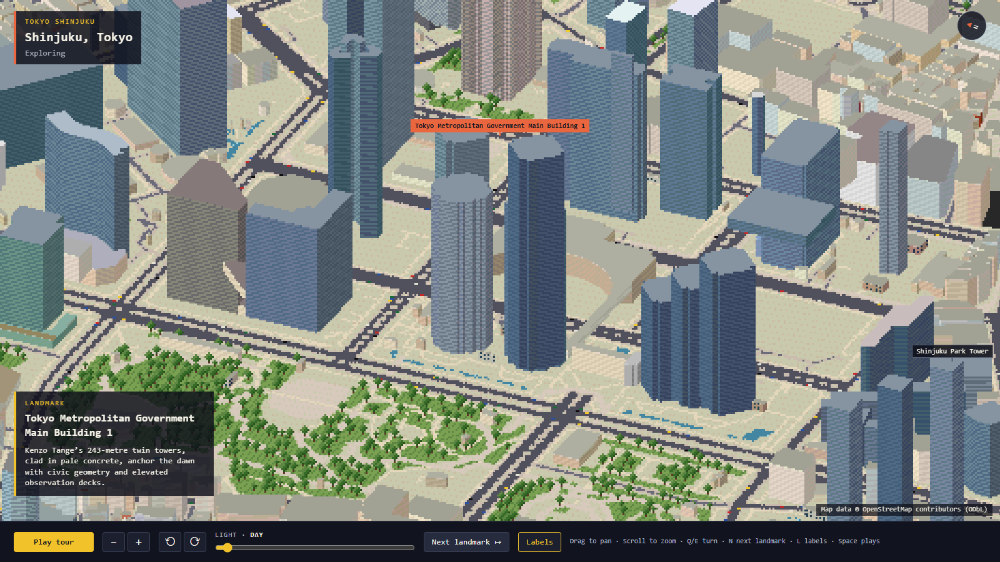

# 🗾 Tokyo Workflow — The Map That Learned to Breathe

| Property | Value |
|---|---|
| **City** | Tokyo, Japan |
| **City ID** | `tokyo` |
| **Coordinates** | `35.6895° N, 139.6917° E` |
| **Selected Official Skill** | `pixel-iso-city` |
| **Film Title** | *Tokyo: The Map That Learned to Breathe* |
| **Film Duration** | 60.00s |
| **Buildings Baked** | 3,544 OpenStreetMap 3D Footprints |
| **Pinned Landmarks** | 8 Shinjuku Skyscraper Highlights |
| **Automated Verification** | ✅ 40/40 Checks Passed |
| **Lab Status** | `pending` |
| **Entry ID** | `9b9a053a-2388-45d7-933b-3f3717a601e0` |
| **Live Contest Link** | [🔗 https://www.sandbase.ai/lab/event/aicityremix/e/9b9a053a-2388-45d7-933b-3f3717a601e0](https://www.sandbase.ai/lab/event/aicityremix/e/9b9a053a-2388-45d7-933b-3f3717a601e0) |

---

## 📸 Visual Showcase

<div align="center">
  
  <p><em>Figure 1: Official cover poster — Isometric pixel-art diorama of Shinjuku's high-rise district at dusk.</em></p>
</div>

<div align="center">
  
  &nbsp;
  
  <p><em>Figure 2: (Left) 3,544 procedural OpenStreetMap buildings; (Right) Focus flight on Mode Gakuen Cocoon Tower.</em></p>
</div>

---

## 📖 Creative Direction & Storytelling

### The Story
- **Angle:** "A Life Story" through Data and Maps.
- **Protagonist:** Emi, an urban cartographer walking across the Shinjuku grid from dawn to midnight. Her digital navigation line transforms from sterile road geometry into the breathing pulse of human connections.

### 8 Pinned Shinjuku Landmarks
1. **Tokyo Metropolitan Government Building (TMG):** Kenzo Tange’s split cathedral towers greeting the dawn.
2. **Park Tower Shinjuku:** Stepped granite towers rising above Shinjuku Central Park.
3. **Shinjuku Nomura Building:** Vertical white sunshade fins catching late morning glare.
4. **Shinjuku Center Building:** Clean mid-century corporate precision and sunken courtyards.
5. **Shinjuku Mitsui Building:** Black exterior steel X-braces engineered against the Earth's tremors.
6. **Mode Gakuen Cocoon Tower:** Elliptical woven aluminum shell symbolizing growth and nurturing ideas.
7. **JR Shinjuku Miraina Tower:** Modern transit gateway stitching rail lines into the city floor.
8. **Tokyu Kabukicho Tower:** Water fountain skyscraper conducting the neon nightlife.

---

## 🎙️ Spoken Narration (MiniMax Speech 2.8 HD)

Voiced by MiniMax Speech 2.8 HD (`English_CaptivatingStoryteller`):

1. **0.0s — TMG:** *"At dawn, Emi follows the map’s blue line toward civic stone waking silver between the twin towers."*
2. **7.5s — Park Tower:** *"Morning gathers at Park Tower, where warm coffee steadies Emi and granite steps divide the city into terraces."*
3. **15.0s — Nomura Building:** *"By late morning, Nomura’s fins turn Emi’s route into a chart, each window marking someone’s work."*
4. **22.5s — Center Building:** *"At noon, Emi eats beneath Center Building’s glass skin, briefly inside a city perfectly ordered."*
5. **30.0s — Mitsui Building:** *"Afternoon sharpens on Mitsui’s black X-braces, while Emi’s messages pulse like small private stars behind the façade."*
6. **37.5s — Cocoon Tower:** *"At dusk, Cocoon Tower wraps Emi in woven light, its curving lattice turning traffic into one luminous thread."*
7. **45.0s — Miraina Tower:** *"Evening, Miraina Tower lifts Emi above the rails; every arriving train stitches another life into the map."*
8. **52.5s — Kabukicho Tower:** *"By night, Kabukicho Tower’s fountain conducts the crowds, and Emi closes her map on the city’s electric pulse."*

---

## ⚙️ How to Reproduce Locally

```bash
# Navigate to Tokyo project
cd tokyo-film

# Bake real OpenStreetMap data around Shinjuku
node scripts/bake-area.mjs --bbox "139.685,35.685,139.705,35.695"

# Build offline bundle
npm run build:single

# Execute 40-point automated test suite
npm run shoot -- --file dist-single/index.html

# Record 60-second video frames and poster
npm run record -- --file dist-single/index.html --out film

# Generate MiniMax speech narration & mux final video
node generate_narration.js
python mix_tokyo_audio.py
python mux_final_film.py
```
