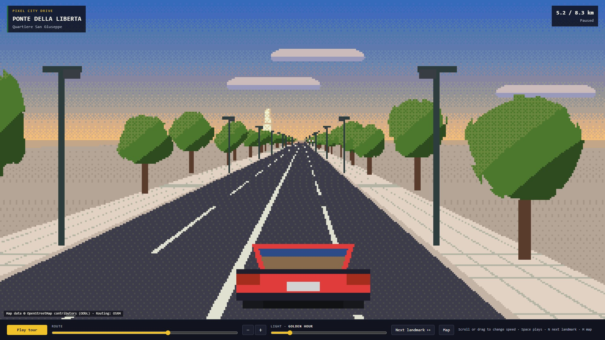

# 🇮🇹 Venice Workflow — The Threshold Across the Lagoon

| Property | Value |
|---|---|
| **City** | Venice |
| **City ID** | `venice` |
| **Coordinates** | `45.437° N, 12.318° E` |
| **Selected Official Skill** | `pixel-city-drive` (adapted to Ponte della Libertà & Piazzale Roma) |
| **Film Title** | *Venice: The Threshold Across the Lagoon* |
| **Film Duration** | 60.00s |
| **Automated Verification** | ✅ 39/39 Checks Passed |
| **Status** | Production Complete · Ready for Entry ID & Token |
| **Open-Source Repo** | [https://github.com/toufiqfarhan0/ai-city-remix-workflows.git](https://github.com/toufiqfarhan0/ai-city-remix-workflows.git) |

---

## 📸 Visual Showcase

  
  
<em>Figure 1: Official cover poster — Pixel art drive across Ponte della Libertà into Venice at golden sunset.</em>

---

## 📖 Creative Direction & Storytelling

### The Brief & Historical Context
- **City:** Venice (Ponte della Libertà & Piazzale Roma)
- **Angle:** *One thing about it (Labyrinth of canals & bridges)*
- **Story Arc (Cross-referenced with Wikipedia & Municipal Archives):**
  1. The drive opens on the open waters of the Venetian Lagoon along the 3,850-meter **Ponte della Libertà** (Liberty Bridge).
  2. Designed by engineer Eugenio Miozzi and opened in 1933, this causeway carries the only vehicular road into Venice.
  3. Wooden *briccole* and historic maritime fortifications (Batteria S. Antonio) emerge from the shallow lagoon waters.
  4. The route approaches the historic island of Cannaregio, passing under overhead bridge frameworks and street signs.
  5. The unmistakable copper dome of the circular eighteenth-century church of **San Simeon Piccolo** greets travelers across the Grand Canal.
  6. The fourteenth-century Gothic facade of **Sant’Andrea della Zirada** marks the ancient threshold where road infrastructure ceases.
  7. At **Piazzale Roma**, every engine stops: the journey surrenders asphalt to stone steps, arched bridges, and gondolas.

---

## 🎙️ Spoken Narration (MiniMax Speech 2.8 HD)

Voiced by MiniMax Speech 2.8 HD (`English_CaptivatingStoryteller`):

1. **0.5s — Lagoon Causeway:** *"Across the shimmering mirror of the Venetian Lagoon, the Ponte della Libertà stretches four kilometres toward the sea."*
2. **8.0s — Engineering History:** *"Built in nineteen thirty-three by Eugenio Miozzi, this slender causeway carries the only road connecting the mainland to Venice."*
3. **16.5s — Salt Marshes & Batteries:** *"To our left and right, historic batteries and wooden briccole guide fishermen through the ancient salt marshes."*
4. **25.0s — Cannaregio Embankments:** *"As the road approaches Santa Chiara, the open lagoon yields to the stone embankments of Cannaregio."*
5. **33.5s — San Simeon Dome:** *"Ahead across the Grand Canal, the great copper dome of San Simeon Piccolo rises like a temple above the water."*
6. **42.0s — Sant'Andrea Threshold:** *"At Sant’Andrea della Zirada, fourteenth-century Gothic walls mark the boundary where asphalt ends and Venice begins."*
7. **50.5s — Carless Venice:** *"Here at Piazzale Roma, every engine falls silent, handing the traveler over to gondolas, bridges, and labyrinthine stone."*

---

## 📚 Fact-Checked Wikipedia & Historical Sources

- [Wikipedia — Ponte della Libertà](https://en.wikipedia.org/wiki/Ponte_della_Libert%C3%A0)
- [Wikipedia — Piazzale Roma](https://en.wikipedia.org/wiki/Piazzale_Roma)
- [Wikipedia — Venetian Lagoon](https://en.wikipedia.org/wiki/Venetian_Lagoon)
- [Wikipedia — San Simeon Piccolo](https://en.wikipedia.org/wiki/San_Simeon_Piccolo)
- [Wikipedia — Sant'Andrea della Zirada](https://en.wikipedia.org/wiki/Sant%27Andrea_della_Zirada)
- [Wikipedia — Grand Canal (Venice)](https://en.wikipedia.org/wiki/Grand_Canal_(Venice))
